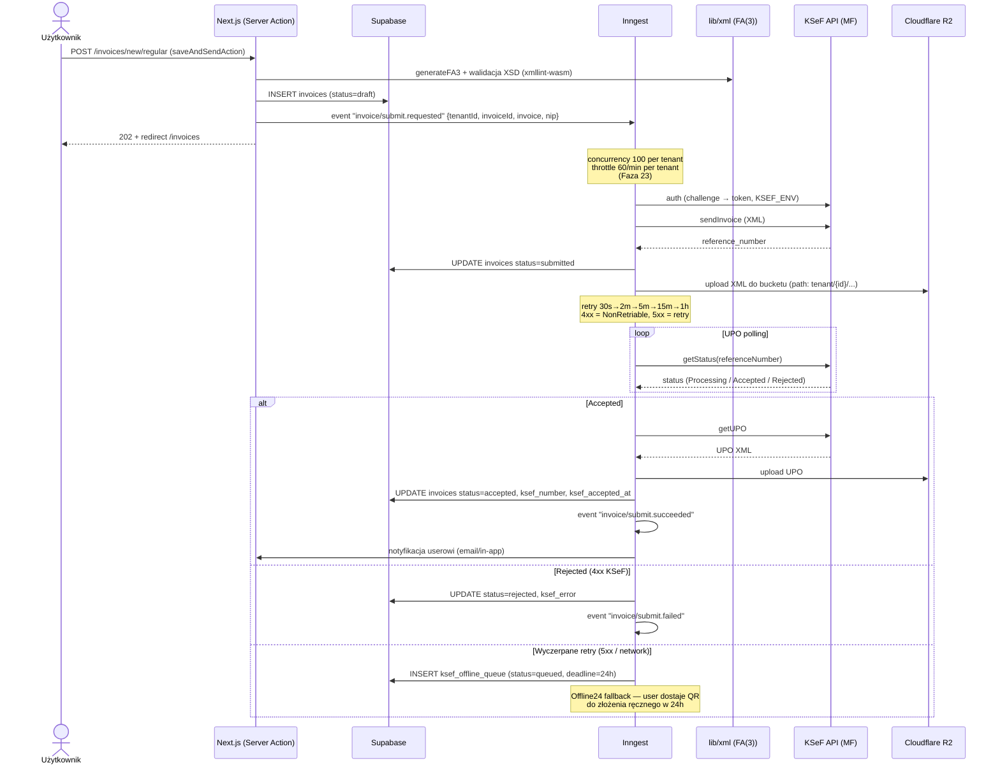

# KSeF Flow — Wysyłka faktury

Pełny lifecycle faktury wychodzącej: od formularza do UPO z KSeF.

## Diagram

## Klucze do zrozumienia

1. **Server Action TYLKO enqueue'uje event** — UI nie czeka na KSeF. To Inngest robi ciężką robotę, retry, throttle.
2. **`KSEF_ENV=test`** w dev/test, **`production`** w prod. Test env NIE waliduje sumy kontrolnej NIP. NIGDY nie używaj prawdziwych NIP w testach.
3. **XML waliduję lokalnie** (`libxmljs2` / `xmllint-wasm`, XSD FA(3)) **PRZED** wysyłką. Lepiej złapać błąd offline niż dostać `400` od KSeF.
4. **UPO osobny krok** — KSeF najpierw zwraca `reference_number`, UPO trafia dopiero po przetworzeniu (sekundy do minut). Stąd polling.
5. **Offline24** — gdy KSeF padnie na > 1h, faktura ląduje w `ksef_offline_queue` z deadline 24h. User dostaje QR. Po powrocie KSeF cron retry'uje (`upoRetryStaleJob`).

## Powiązany kod

- `lib/inngest/jobs/submit-invoice.ts` — główny job
- `lib/inngest/jobs/download-upo.ts` — pobranie UPO
- `lib/inngest/jobs/process-offline-queue.ts` — retry Offline24
- `lib/ksef/` — klient KSeF (auth, submit, status, UPO)
- `lib/xml/fa3-generator.ts` — generator XML FA(3)
- `lib/xml/validator.ts` — walidacja XSD
- Tabele: `invoices`, `ksef_submissions`, `upo_receipts`, `ksef_offline_queue`, `ksef_sessions`, `xml_documents`

## Ślad w `audit_logs` (Faza 23 sekcja 3, zawężona w EXT-03)

Wywołanie KSeF z kontekstem audytu zapisuje wiersz `ksef.<akcja>` (status
HTTP, czas, rozmiary). Od sesji 26 planu skalowania (EXT-03) zależy to od
rodzaju wywołania (`audit.when` w `lib/ksef/client.ts`):

| Wywołanie | Wiersz | Dlaczego |
|---|---|---|
| `session.open`, `invoice.send`, `session.close`, `invoice.download-original`, `invoice.original-metadata`, UPO | przy każdym wywołaniu | zmienia stan albo jest dowodem wysyłki |
| `invoice.reconcile`, `session.invoices` | przy każdym wywołaniu | od odpowiedzi zależy, czy wysyłamy fakturę ponownie |
| `inbox.poll` (strona skrzynki co 15 min) | błąd żądania (spoza 2xx, timeout, sieć) + jeden wiersz podsumowania na przebieg, który dodał faktury | zwykła strona niczego nie zmienia; przy 2000 firm to ok. 6 mln wierszy miesięcznie |
| `invoice.poll` (status po wysyłce, do 30 prób) | błąd żądania + jeden wiersz podsumowania na fakturę: próby, czas, wynik, kod statusu KSeF | jw. |
| `history.query` (synchronizacja historii) | przy każdym wywołaniu | jednorazowe pobranie archiwum firmy, każda strona niesie nowe dane |

Wiersz podsumowania ma tę samą akcję co wiersz błędu i `metadata.summary =
true` (`lib/ksef/poll-audit.ts`). Dowodem wysyłki pozostają `ksef_submissions`
i wiersze otwarcia, wysyłki i zamknięcia sesji.

## Retry schedule

| Próba | Po jakim czasie | Powód |
|---|---|---|
| 1 | natychmiast | sieć blip |
| 2 | 30 s | krótki incydent KSeF |
| 3 | 2 min | dłuższy incydent |
| 4 | 5 min | utrzymujący się problem |
| 5 | 15 min | poważna awaria |
| 6 (ostatnia) | 1 h | „już dawno powinno wrócić" |
| Po 6 | — | → `ksef_offline_queue` (Offline24) |
