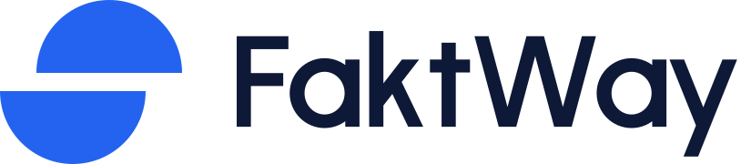
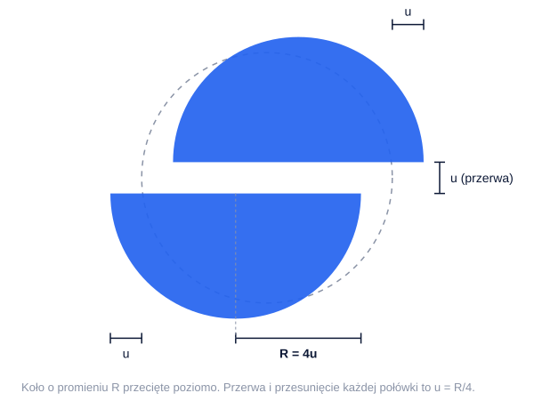
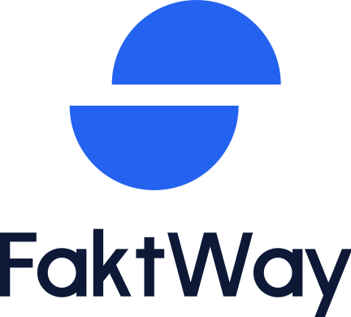
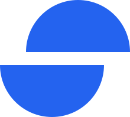
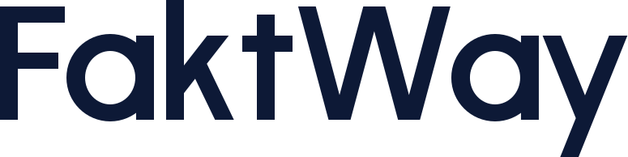
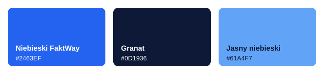
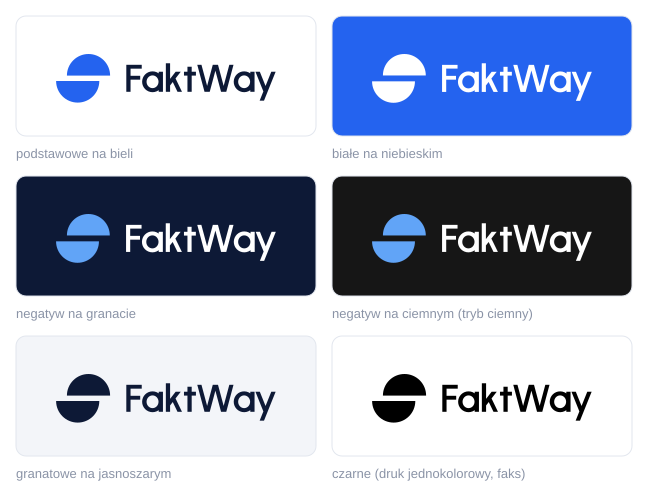
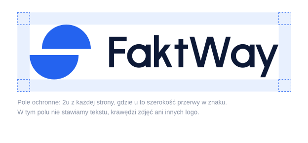
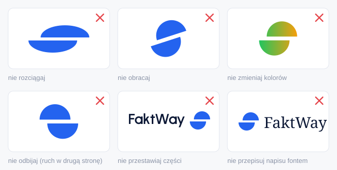
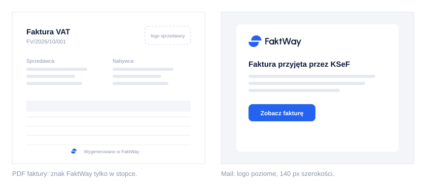

# Logo FaktWay



## Który plik gdzie

| Gdzie | Plik |
|---|---|
| strona, aplikacja, maile (jasne tło) | `zestaw/svg/faktway-logo.svg` |
| tryb ciemny, ciemne tła | `zestaw/svg/faktway-logo-negatyw.svg` |
| na niebieskim tle | `zestaw/svg/faktway-logo-biale.svg` |
| PDF faktury, dokumenty | `zestaw/svg/faktway-logo.svg` (w generatorze PDF), poza kodem `zestaw/png/faktway-logo-na-bialym-1200.png` |
| drukarnia | `zestaw/pdf/*.pdf` (wektorowe) i ta instrukcja |
| favicon, ikona PWA, iPhone | cały katalog `zestaw/web/` (gotowy fragment `<head>` w `head-snippet.html`) |
| awatar w mediach społecznościowych | `zestaw/web/icon-512.png` (biały znak na niebieskim) |
| kwadratowe miejsca (okładka, prezentacja) | `zestaw/svg/faktway-logo-pionowe.svg` |
| tam, gdzie nazwa pada obok (np. ikona przy przycisku) | `zestaw/svg/faktway-znak.svg` |

SVG to pliki wzorcowe: same kształty, bez fontów i obrazów. PNG są przezroczyste, w szerokościach 1200 i 2400 px (znak: 512, 1024, 2048).

## Idea

**Koło przecięte na pół, połówki jadą w przeciwne strony: faktury wychodzą i wracają, a całość dalej się zgadza.** Koło i symetria dają spokój i pewność, przesunięcie daje ruch i lekkość. Znak jest środkowo symetryczny: obrócony o 180° wygląda tak samo, odbity w lustrze jedzie w złą stronę (dlatego nie odbijamy).



Konstrukcja w jednej regule: jednostka **u** to szerokość przerwy. Promień koła 4u, przerwa 1u, każda połówka przesunięta o 1u. Z tej samej jednostki wynikają układy z napisem i pole ochronne.

## Wersje

| Wersja | Kiedy |
|---|---|
|  **poziome (podstawowe)** | domyślnie wszędzie |
|  **pionowe** | miejsca kwadratowe i wysokie |
|  **sam znak** | ikony, favicon, awatar; tam, gdzie nazwa jest już obok |
|  **sam napis** | wąskie paski, gdzie znak się nie mieści |

Każda wersja ma warianty kolorystyczne: podstawowy (niebieski znak, granatowy napis), `-niebieskie`, `-granat`, `-czarne`, `-biale`, `-negatyw`. Białe i negatyw są lekko odchudzone (szersza przerwa, cieńsze litery), bo jasny kształt na ciemnym tle optycznie puchnie. Nie zastępuj ich przekolorowaną wersją podstawową.

Układ poziomy: wysokość wersalików napisu 5u, odstęp między znakiem a napisem 3u, środek znaku na środku wersalików. Układ pionowy: wersaliki 3u, odstęp 2u. Części układów nie przestawiamy i nie skalujemy osobno.

## Kolory



| Nazwa | HEX | RGB | CMYK | Pantone (przybliżenie) | Do czego |
|---|---|---|---|---|---|
| Niebieski FaktWay | `#2463EF` | 36 99 239 | 85 59 0 6 | 2727 C | znak, przyciski, akcenty |
| Granat | `#0D1936` | 13 25 54 | 76 54 0 79 | 282 C | napis, ciemne tła |
| Jasny niebieski | `#61A4F7` | 97 164 247 | 61 34 0 3 | 284 C | znak na ciemnym tle (tylko ekran) |

Niebieski to dokładnie `--primary` z `app/globals.css`, jasny niebieski to `--primary` trybu ciemnego, więc logo i interfejs są jednym kolorem. Kontrast: niebieski na bieli 5,1 : 1, granat na bieli 17,4 : 1, jasny niebieski na tle trybu ciemnego 7,0 : 1.

CMYK policzone matematycznie z RGB, a Pantone dobrane jako najbliższe z pamięci wzornika. Przed pierwszym drukiem drukarnia musi dopasować oba na próbnym wydruku: tak nasycony niebieski częściowo wypada poza zakres CMYK.

## Tła



Na zdjęciach: wersja biała albo granatowa na spokojnym fragmencie zdjęcia. Jeśli tło jest zbyt pstre, wstaw sam znak w niebieski kafel (`zestaw/web/faktway-znak-app-icon.svg`).

## Pole ochronne i minimalne rozmiary



Wokół logo zostaw **2u** wolnego miejsca (w układzie poziomym to około 5% jego szerokości). Pole rośnie razem z logo.

| Wersja | Ekran | Druk |
|---|---|---|
| poziome | 120 px szerokości | 30 mm |
| pionowe | 72 px szerokości | 18 mm |
| sam napis | 80 px szerokości | 20 mm |
| sam znak | 24 px | 6 mm |
| znak 16-23 px | `faktway-znak-maly.svg` (narysowany na siatkę pikseli, przerwa 2 px) | |

## Czego nie robić



Nie rozciągaj, nie obracaj, nie odbijaj, nie zmieniaj kolorów spoza palety, nie dodawaj cieni, obrysów ani gradientów, nie przestawiaj części i nie przepisuj napisu żadnym fontem. Napis to rysunek, nie tekst.

## Typografia obok logo

Napis „FaktWay” jest narysowany od zera z figur geometrycznych i nie istnieje jako font. Tekst obok logo składaj fontem aplikacji: **Outfit** (licencja SIL OFL, interfejs i nagłówki), liczby i kody **IBM Plex Mono**. Outfit jest geometryczny jak napis, więc się nie gryzą.

## W użyciu



Więcej makiet (strona, zakładka, ikona aplikacji, profil, wizytówki, naklejka): `plansza.html`.

## Pliki i jak je odtworzyć

```
docs/brand/logo/
  README.md            ta instrukcja
  BRIEF.md             brief, lista koncepcji, dlaczego A
  plansza.html         plansza z makietami
  koncepcje-runda1.png arkusz z rundy koncepcji (A, B, C)
  zestaw/svg/          pliki wzorcowe (23)
  zestaw/png/          PNG przezroczyste
  zestaw/pdf/          PDF wektorowe do druku (RGB)
  zestaw/web/          favicon.ico i .svg, ikony PWA, apple-touch-icon, site.webmanifest, head-snippet.html
  zestaw/instrukcja/   ilustracje do tej instrukcji
  zrodla/              generatory (Python 3, bez zależności) i spec planszy
```

Po zmianie geometrii (z katalogu `docs/brand/logo/zrodla`):

```bash
python3 kit.py ../zestaw/svg && python3 instrukcja.py ../zestaw && ./eksport.sh
```

`eksport.sh` potrzebuje `rsvg-convert` (`brew install librsvg`). Katalog `zestaw/web/` wygenerował skrypt `export_variants.py` ze skilla logo-design (ikony z białej wersji znaku na `#2463EF`), a favicony 16/32/48 px i `favicon.svg` (z przełączeniem na jasny niebieski w trybie ciemnym) są renderowane prosto z `faktway-znak-maly.svg`, żeby trzymały siatkę pikseli.

## Notatki przekazania

**Decyzje.**
- Kierunek A wybrany 24.10.2026 z trzech koncepcji (`koncepcje-runda1.png`, uzasadnienie w `BRIEF.md`).
- Proporcje ustalone na jedną regułę (R = 4u), żeby każdy wymiar w układach i instrukcji dało się z niej wyprowadzić.
- Kolor wzięty 1 : 1 z aplikacji zamiast nowego, bo logo i interfejs mają się czytać jako jedno. Niebieski jest kolorem kategorii, więc wyróżnia kształt, nie kolor.
- Napis jest rysunkiem (bez licencji fontu). Litery: trzon 22, poziome kreski 20, ukośne 21, wszystkie zakończenia cięte poziomo jak przecięcie w znaku, W dokładnie 15° od pionu.

**Testy wykonane.** `svg_audit.py` na wszystkich 23 plikach: 98-100/100, bez ostrzeżeń. Arkusz testów (rozmiary od 16 px, tła, jeden kolor, rozmycie, odbicie, obrót, półka z logo fintechu), porównanie ze wzorcowymi znakami z biblioteki skilla, powiększenia połączeń kresek w napisie, wersje odchudzone obok podstawowych na granacie, minimalne rozmiary w prawdziwych pikselach.

**Otwarte sprawy.**
- Sprawdzenie znaku w bazach znaków towarowych (EUIPO, UPRP) i wyszukiwanie obrazem. Nie da się tego zagwarantować projektem.
- CMYK i Pantone do potwierdzenia na próbnym wydruku.
- PDF są w RGB. Jeśli drukarnia zażąda CMYK albo AI/EPS, trzeba je zrobić w programie graficznym z plików SVG.
- Napis to nakładające się kształty w jednej ścieżce: na ekranie i w druku wyglądają jak jeden kształt, ale do ploterów, wycinania folii i haftu trzeba je scalić w programie graficznym (Scal / Unite).
- Logo nie jest jeszcze podpięte w aplikacji: nagłówek strony i aplikacji, `public/favicon/`, manifest PWA, maile, PDF faktury.
